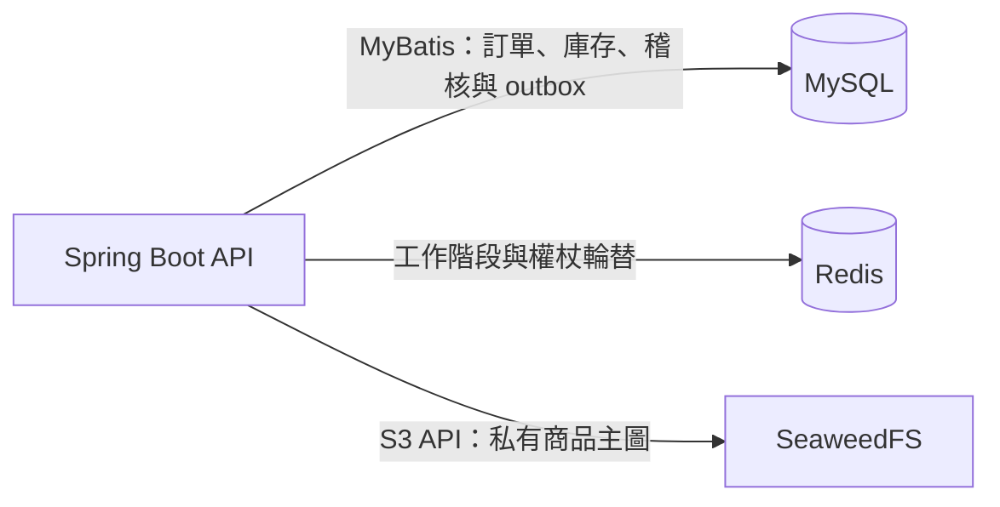

# Figura

*A shared commerce API for a figure and collectibles shop, serving web and Flutter clients.*

Figura 是公仔／收藏品單店的後端作品，原名 ELPSY Shop，介面仍沿用舊名稱。
本倉庫提供 [網路商店與員工後台](https://github.com/jackteng-dev/figura-web)、[Flutter 顧客 App](https://github.com/jackteng-dev/figura-app) 共用的 API，支援顧客購物與店員管理商品、庫存及訂單。
以現貨交易與整筆預購為範圍，處理重複請求、庫存競爭及付款結果不確定時的狀態核對；付款、配送與通知皆為模擬。

## 展示

- [公開唯讀商店展示](https://swaggyserver.tail5b604b.ts.net:8443/demos/shop/)：目前沒有商品，僅供查看頁面，不提供交易操作。
- [作品展示入口](https://swaggyserver.tail5b604b.ts.net:8443/)：可從入口進入商店唯讀頁。
- 員工管理與完整寫入流程不在公開展示範圍，可依下方步驟建立自己的隔離環境。

## 主要功能

- 商品與 SKU 草稿、上架／下架／封存，品牌／作品／分類主檔，以及單張商品主圖管理與公開讀取。
- 庫存調整、版本檢查與異動稽核；區分實體庫存、保留量與可售量。
- 顧客註冊／登入、本人購物車與地址；現貨訂單價格／收件快照、庫存保留、取消與逾時釋放。
- 模擬付款與異常付款核對、出貨／送達、未出貨全額退款，以及已出貨整筆退貨驗收與退款。
- 獨立預購批次、配額保留、模擬整筆付款／退款、到貨登記、整筆分配及模擬履約。
- 員工角色／權限與存取稽核、顧客 App Bearer API，以及通知 outbox、模擬派送、重試與人工重排。

## 技術架構

| 層 | 技術 |
| --- | --- |
| API 與業務邏輯 | Java 17、Spring Boot 3.2.1、Bean Validation |
| 身分與授權 | Spring Security、JWT、網站 Cookie／CSRF、App Bearer |
| 資料存取 | MyBatis 3.0.3、MySQL 8.4、Flyway V1–V18 |
| 工作階段 | Redis 7 |
| 商品圖片 | SeaweedFS 3.85、AWS SDK for Java v2（S3 API）|
| 建置與交付 | Maven、Docker Compose、GitHub Actions、私有 GHCR |

以下為本 API 與展示 Compose 的執行元件；SeaweedFS 由 `images` profile 啟用，排程在 API 程序內執行。



## 工程重點

- **防止重複交易**：以 UUID、原請求內容與操作者核對冪等性；同一操作重送回傳原結果與目前狀態，識別碼碰撞拒絕處理。付款晚到成功保留待核對證據，不復活已結束訂單。[付款合約](docs/PAYMENTS_API.md)
- **庫存與配額一致性**：現貨以固定鎖定順序及 MySQL 列鎖處理下單競爭，訂單、保留量與事件同交易提交；預購另有獨立供應與配額，不借用現貨庫存。[現貨訂單](docs/ORDERS_API.md)／[預購合約](docs/PREORDERS_API.md)
- **身分與授權隔離**：員工、網站顧客及 App 使用分離的 realm／session；本人資料只取已驗證 Principal，寫入時重新檢查員工啟用與權限，並保護最後一位管理員。[App 身分](docs/MOBILE_API.md)／[員工治理](docs/STAFF_ACCESS_API.md)
- **跨儲存失敗復原**：私有圖片先驗證再重新編碼；以持久清理佇列追蹤 SQL 回滾或程序中斷後的 S3 暫存物件，清理前再次檢查引用。[圖片設計](docs/IMAGES_API.md)
- **通知與業務解耦**：outbox 與訂單事件同交易寫入，派送另行執行；固定 delivery key 核對未知結果，搭配退避重試與 DEAD 人工重排。現有接收端僅為本地 mock。[通知設計](docs/NOTIFICATIONS_API.md)

## 品質與交付

- 測試包含身分／權限、版本競爭、冪等重送、交易回滾，以及隔離 MySQL／Redis／SeaweedFS 整合情境；另有 HTTP smoke 腳本。
- [交接文件](docs/HANDOFF.md) 記錄 2026-10-08 的 `mvn package` 結果：262 項中 260 通過、2 項歷史升級 fixture 略過，無失敗或錯誤。這是文件中的歷史結果，本次文件整理未重跑。
- GitHub Actions 的 [`verify`](.github/workflows/showcase-verify.yml) 在 PR 與 main 執行，由 [CI 腳本](scripts/homelab-ci.py) 建立隔離依賴並執行 Maven `verify`。
- 交付流程為 PR → `verify` 通過 → 合併 main → main CI 成功後[發布私有 GHCR 映像](.github/workflows/homelab-release.yml) → 擁有者自架主機定時拉取，以固定 digest 配對部署 Web／API。主機端 CD 由獨立環境管理，交付紀錄見交接文件。

## 本機啟動

準備 JDK 21（編譯目標 Java 17）、Maven 3.9、Python 3 與 Docker Compose，在本倉庫根目錄執行。
僅用全新、隔離的 `elpsy_shop_demo`；私有設定產生器不覆蓋既有檔案，也不重設既有帳號密碼。

```sh
python3 scripts/init_demo_env.py
python3 scripts/init_images_env.py
docker compose --env-file work/demo.env -f docker-compose.demo.yml --profile images up -d
# 確認 MySQL healthy 後，載入自己產生的可信私有設定
set -a
. ./work/demo.env
set +a
mvn package
java -jar target/ELPSY_Shop-AP-1.0-SNAPSHOT.jar --spring.profiles.active=demo
```

demo API 路徑為 `/ELPSY/api`，連接埠為 `19092`；Spring 不會自行載入 `.env`。
上述一般建置未啟用真實服務整合測試；啟用旗標、隔離測試與 Web 配對啟動方式見[詳細啟動文件](docs/NEW_MACHINE_SETUP.md)。

## 已知限制

- 本作品為展示與演練用途：沒有真實收款、退款轉帳、物流託運或真人通知，不代表正式商務營運驗收完成。
- 以單店、單機環境起步；尚無多機容錯與正式壓測保證。圖片清理需排程持續運行，SQL 與 S3 並非分散式原子交易。
- 商品限單張主圖；預購以整筆流程為範圍，訂金尾款、延期與部分退款屬後續擴充。
- 原資料移轉、商家服務、會員安全補強及 App 真機／商店上架仍需另行驗收，詳見[後續驗收清單](docs/CLOUD_LOCAL_FOLLOWUP.md)。

## 文件

- [新機與隔離環境設定](docs/NEW_MACHINE_SETUP.md)、[最新交接](docs/HANDOFF.md)、[路線圖](docs/ROADMAP.md)
- [現貨訂單](docs/ORDERS_API.md)、[付款與異常核對](docs/PAYMENTS_API.md)、[預購流程](docs/PREORDERS_API.md)
- [員工權限治理](docs/STAFF_ACCESS_API.md)、[App API](docs/MOBILE_API.md)、[圖片儲存](docs/IMAGES_API.md)、[通知 outbox](docs/NOTIFICATIONS_API.md)
- [正式環境與裝置待驗收](docs/CLOUD_LOCAL_FOLLOWUP.md)
- [開發紀錄：原 README 完整里程碑](docs/DEV_LOG.md)
